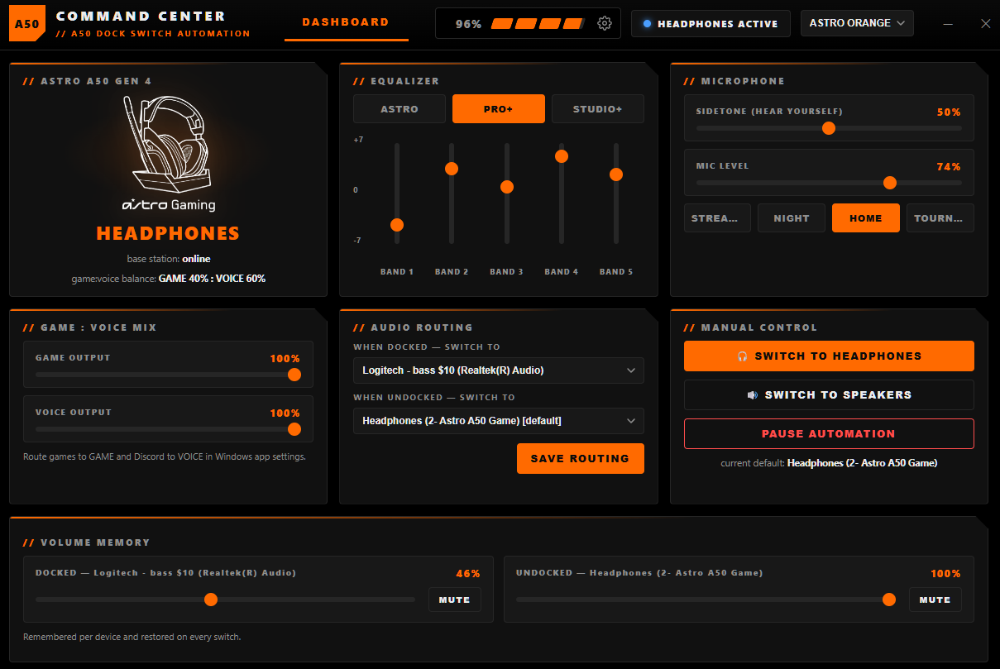

# A50 Dock Switch — macOS

[](https://github.com/vallhaofficial/a50-dock-switch-mac/actions/workflows/build.yml)

Native Swift port of [a50-dock-switch](https://github.com/bboymain/a50-dock-switch): a menu bar app that watches your Astro A50 Gen 4 dock state over USB HID and switches your default audio output for you. **Docked → speakers. Undocked → headphones.**

Runs natively on **macOS 14+** — no Python, no WebView wrapper, no Electron. The Astro Command Center-style dashboard is a native SwiftUI port of the upstream web UI.

> The screenshot below is the **Windows** build — the macOS dashboard is a like-for-like port of this design. A native macOS capture goes here as soon as one is taken.



## Features

- **Automatic switching** — dock detection over USB HID, ~1 second to switch
- **Menu bar** — live dock state and battery, manual override, device routing
- **Command Center dashboard** — native SwiftUI, three themes (Astro Orange / Neon Glass / Minimal Dark): 3 EQ presets × 5 bands, sidetone, mic level, noise gate, game:voice balance, audio routing, manual control, poll settings and an event history
- **Headset storage** — save EQ/mic settings to the headset with `SAVE_VALUES`. Without a save they live only in the base station's working copy and vanish when it powers off
- **Real EQ band frequencies** — read from the device (`0x70`) rather than assumed; the bands are 36 / 170 / 2753 / 6691 / 11002 Hz, not evenly spaced
- **Live telemetry** — battery percentage with charge state, dock state, base-station status
- **Autostart** — optional "Start at login"
- **Notifications** — a notification on every switch

## Platform differences from Windows

| Upstream (Windows) | This port (macOS) |
|---|---|
| GAME / VOICE **output** sliders | read-only balance — macOS exposes **no** volume property on the A50 Game/Voice endpoints, so per-channel volume can't be set |
| Volume memory per device | unavailable for the same reason; the dashboard says so rather than hiding it |
| "Start with Windows" | "Start at login" via `SMAppService` |
| Update checks against GitHub releases | not ported |

Everything else — dock switching, EQ, sidetone, mic, noise gate, persistence — works the same.

## Requirements

- macOS 14 (Sonoma) or later, Apple silicon or Intel
- Astro A50 Gen 4 with the base station connected over USB
- Xcode (any toolchain that ships a macOS SDK) to build from source

## Build & run

```sh
./scripts/build_app.sh
```

That builds the release binary, assembles `A50DockSwitch.app`, copies the icon and resources, and installs it to `/Applications`. It replaces any running copy first, so the bundle is never rewritten under a live process.

Then open it from `/Applications`, or Spotlight-search **A50**. The app lives in the menu bar; choose **Headset Dashboard…** (⌘D) for the panel.

## a50probe — protocol diagnostics

Same idea as `probe.py` in the Windows repo. Run this first if switching doesn't work:

```sh
swift build
.build/debug/a50probe              # list interfaces + 5 snapshots, 2s apart
.build/debug/a50probe --list       # HID interfaces (usage page / usage / openable)
.build/debug/a50probe --settings   # full settings snapshot incl. saved values
.build/debug/a50probe --cmd 0x54   # raw dump: headset status
.build/debug/a50probe --cmd 0x70 01 01   # EQ band 1 freq/bandwidth (payload args)
.build/debug/a50probe --raw-test   # framing sweep across every command
```

Quit the app first: it seizes the HID interface on purpose, so a second client fails loudly instead of silently misreading someone else's replies.

## How it works

- **HID** — `Sources/A50HID/AstroHID.swift` talks to VID `0x9886` / PID `0x002C` over usage page `0xFF32` / usage `0x74`. The device reports `maxFeatureReportSize == 1`, so feature reports are unusable: everything goes over interrupt OUT/IN as `[0x02, cmd, len, payload…]`, answered by `[0x02, status, len, payload…]` where `0 = no response`, `1 = error`, `2 = OK`.
- **Commands** — `0x54` dock/on, `0x7C` battery, `0x62`/`0x68` sliders, `0x63`/`0x69` EQ gains, `0x64`/`0x6A` noise gate, `0x67`/`0x6C` active preset, `0x6E` preset name, `0x70` band frequency, `0x72` balance, `0x61` save.
- **Audio switching** — `Sources/A50DockSwitch/AudioDevices.swift` sets `kAudioHardwarePropertyDefaultOutputDevice` through CoreAudio.
- **Polling/debounce** — `Sources/A50DockSwitch/AppState.swift` polls every 0.5s, acts at the configured interval, and requires N matching reads before switching, like the Windows app.
- **Config** — `~/Library/Application Support/A50DockSwitch/config.json`.

## Known caveats

- **ASTRO Command Center must stay closed** while this runs — it claims the vendor HID interface exclusively (same conflict as on Windows).
- The base station occasionally drops off the USB bus during heavy raw testing; replug it if `a50probe --list` comes up empty.
- The app is unsigned, so Gatekeeper will complain if you distribute it. Local builds are fine.
- The build script falls back to driving SwiftPM with an explicit `SDKROOT` if `xcrun` can't resolve the SDK (this happens after an Xcode update whose licence hasn't been accepted yet).

## Credits

- [a50-dock-switch](https://github.com/bboymain/a50-dock-switch) by [@mainlek](https://x.com/mainlek) — original Windows app, dashboard design and the Astro artwork
- [hyperheadset](https://github.com/HyperRaccoon13/HyperHeadset), [eh-fifty](https://github.com/tdryer/eh-fifty) — protocol research

MIT.
